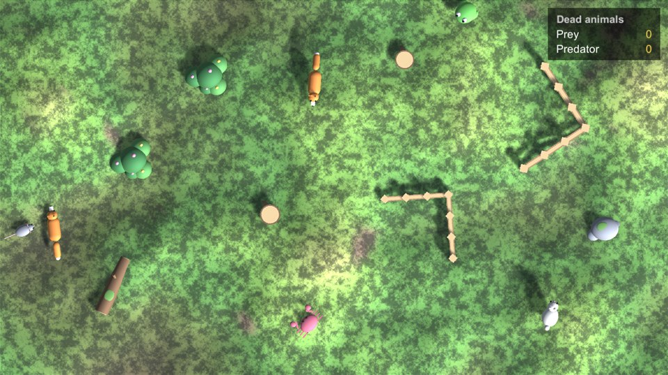
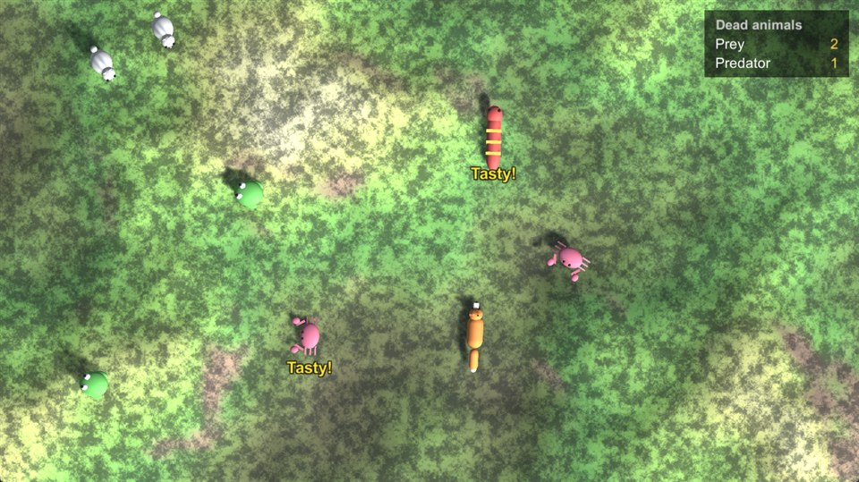
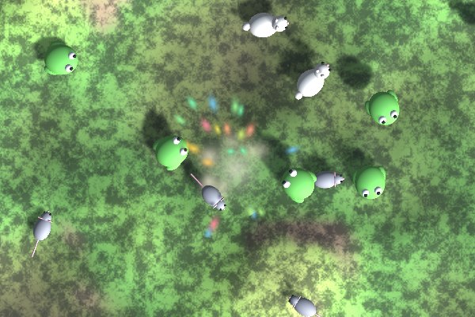
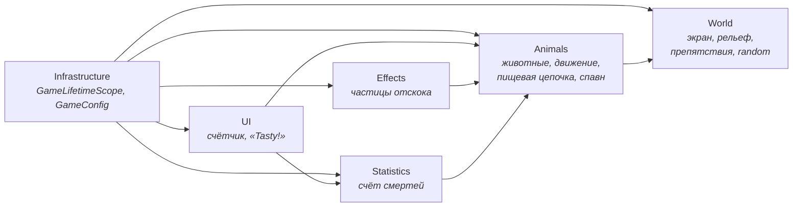
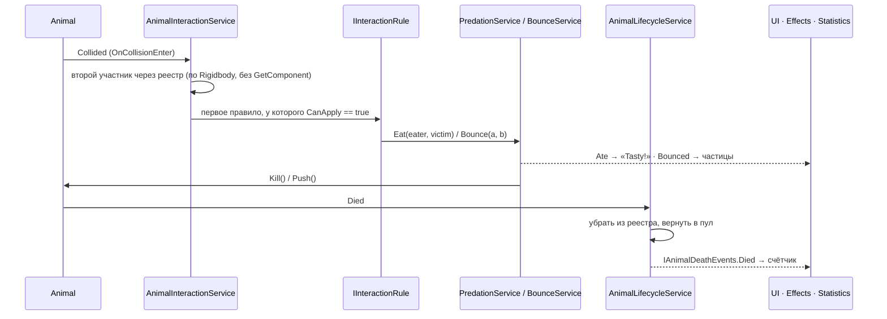

# 🦊 Zoo World


Тестовое задание: 3D-зоопарк с видом сверху. Раз в 1–2 секунды появляется животное и бродит по полю. Хищники едят всех, жертвы при столкновении разлетаются, из двух встретившихся хищников выживает один. Над поевшим хищником появляется **«Tasty!»**, в правом верхнем углу ведётся счётчик погибших (uGUI).

Главное в задании — **архитектура животных**, рассчитанная на добавление «1000 разных видов». Поэтому здесь **новое животное — это ассеты, а не код**.

| | |
|---|---|
|  |  |
| Поле с рельефом и препятствиями | Хищники, «Tasty!» и счётчик смертей |
|  | |
| Отскок двух жертв с эффектом частиц | |

---

## Содержание

- [Быстрый старт](#-быстрый-старт)
- [С чего начать ревью](#-с-чего-начать-ревью)
- [Соответствие ТЗ](#-соответствие-тз)
- [Сверх ТЗ](#-сверх-тз)
- [Архитектура коротко](#-архитектура-коротко)
- [Как добавить новое животное](#-как-добавить-новое-животное)
- [Структура проекта](#-структура-проекта)
- [Тесты](#-тесты)
- [Решения и компромиссы](#-решения-и-компромиссы)

---

## 🚀 Быстрый старт

**Требования:** Unity **2022.3.62f3** (LTS), Windows / macOS. Интернет нужен при первом открытии: VContainer, UniTask и R3.Unity подтягиваются из OpenUPM.

1. Открыть папку проекта в Unity Hub → **Add project from disk**.
2. Дождаться импорта. Пакеты из `Packages/manifest.json` подтянутся сами.
3. Открыть сцену **`Assets/_Project/Scenes/Game.unity`**.
4. Нажать **Play**.

| Действие | Как |
|---|---|
| Запустить тесты | Window → General → **Test Runner** → EditMode → **Run All** |
| Собрать билд | File → Build Settings → Windows → Build. Папка `Builds/` в `.gitignore`, окно по умолчанию 1600×900, размер можно менять |
| Покрутить баланс | `Assets/_Project/Configs/GameConfig.asset`: спавн, отскок, длительность «Tasty!» |
| Поменять животных | `Assets/_Project/Configs/Animals/*.asset` и `Configs/Movement/*.asset` |
| Поменять рельеф | `Assets/_Project/Configs/TerrainConfig.asset` |
| Поменять препятствия | `Assets/_Project/Configs/ObstacleFieldConfig.asset` |

Тесты из командной строки:

```bash
Unity -batchmode -projectPath . -runTests -testPlatform EditMode -testResults results.xml
```

---

## 🧭 С чего начать ревью

Рекомендуемый порядок, примерно 15 минут:

1. **[`GameLifetimeScope.cs`](Assets/_Project/Scripts/Infrastructure/GameLifetimeScope.cs)** — корень композиции. Весь граф объектов на одной странице, сгруппирован по модулям (`RegisterWorld`, `RegisterMovement`, `RegisterFoodChain` и т. д.).
2. **[`Animal.cs`](Assets/_Project/Scripts/Animals/Core/Animal.cs)** и **[`IAnimal.cs`](Assets/_Project/Scripts/Animals/Core/IAnimal.cs)** — тонкий `MonoBehaviour`. Он только передаёт тик в стратегию движения и публикует события. Кто кого ест, пул, статистику и UI он не знает.
3. **[`AnimalConfig.cs`](Assets/_Project/Scripts/Animals/Core/AnimalConfig.cs)** + ассеты в [`Configs/Animals`](Assets/_Project/Configs/Animals) — животное как данные: префаб, роль в пищевой цепочке, конфиг движения.
4. **Движение** — [`MovementStrategy<TConfig>`](Assets/_Project/Scripts/Animals/Movement/Strategies/MovementStrategy.cs), [`MovementStrategyFactory`](Assets/_Project/Scripts/Animals/Movement/Factory/MovementStrategyFactory.cs) и билдеры. Новый тип движения подключается без `switch`.
5. **Пищевая цепочка** — [`FoodChainRole`](Assets/_Project/Scripts/Animals/FoodChain/Roles/FoodChainRole.cs) (кого можно есть, задаётся данными), [`IInteractionRule`](Assets/_Project/Scripts/Animals/FoodChain/Interaction/IInteractionRule.cs) и три правила, [`AnimalInteractionService`](Assets/_Project/Scripts/Animals/FoodChain/Interaction/AnimalInteractionService.cs).
6. **[`docs/ARCHITECTURE.md`](docs/ARCHITECTURE.md)** — подробное описание модулей, сценариев и правил расширения.
7. **[Тесты](Assets/_Project/Tests/EditMode)** — правила, движение, рельеф, препятствия, спавн и целостность ассетов проверяются без сцены.

---

## ✅ Соответствие ТЗ

| Требование | Реализация |
|---|---|
| Вид сверху | Ортографическая камера в `Game.unity`. Границы видимой области даёт [`ScreenBounds`](Assets/_Project/Scripts/World/ScreenBounds.cs) |
| Животное появляется каждые 1–2 с | [`AnimalSpawner`](Assets/_Project/Scripts/Animals/Spawning/AnimalSpawner.cs) (UniTask) + `SpawnConfig` в `GameConfig` |
| Двигается случайно | [`WanderDirectionProvider`](Assets/_Project/Scripts/Animals/Direction/WanderDirectionProvider.cs) |
| Сталкивается с другими по физике | `Rigidbody` + `Animal.OnCollisionEnter` → событие `Collided` → `AnimalInteractionService` |
| Вышло за экран — разворачивается | `WanderDirectionProvider` разворачивает заранее, [`ArenaWalls`](Assets/_Project/Scripts/World/ArenaWalls.cs) страхуют невидимыми стенами |
| Жертва + жертва — разлетаются | Физический материал + [`BounceRule`](Assets/_Project/Scripts/Animals/FoodChain/Interaction/BounceRule.cs) / [`BounceService`](Assets/_Project/Scripts/Animals/FoodChain/Bounce/BounceService.cs) |
| Хищник ест всех | [`PredationRule`](Assets/_Project/Scripts/Animals/FoodChain/Interaction/PredationRule.cs) |
| Хищник + хищник — выживает один | [`MutualPredationRule`](Assets/_Project/Scripts/Animals/FoodChain/Interaction/MutualPredationRule.cs) + [`MostMealsDuelResolver`](Assets/_Project/Scripts/Animals/FoodChain/Duels/MostMealsDuelResolver.cs) |
| «Tasty!» под хищником | [`TastyLabelPresenter`](Assets/_Project/Scripts/UI/TastyLabel/TastyLabelPresenter.cs) (пул подписей, UniTask-таймер) |
| Лягушка прыгает раз в X секунд на фиксированную дистанцию | [`JumpMovementStrategy`](Assets/_Project/Scripts/Animals/Movement/Strategies/JumpMovementStrategy.cs) + `FrogJump.asset`. Скорость прыжка считается баллистически: `v = √(d·g / sin 2θ)` |
| Змея ползёт линейно | [`LinearMovementStrategy`](Assets/_Project/Scripts/Animals/Movement/Strategies/LinearMovementStrategy.cs) + `SnakeLinear.asset` |
| Счётчик погибших жертв и хищников, uGUI, справа сверху | [`DeathStatistics`](Assets/_Project/Scripts/Statistics/DeathStatistics.cs) (`ReactiveProperty`) + [`DeathCounterPresenter`](Assets/_Project/Scripts/UI/DeathCounter/DeathCounterPresenter.cs) (MVP) |
| Архитектура под 1000 животных | Животное, движение и пищевая цепочка задаются данными (см. [ниже](#-как-добавить-новое-животное)) |
| DI и фреймворки | VContainer, R3, UniTask |
| Паттерны | Composition Root, Strategy, Factory + Builder, Rule (Chain of Responsibility), Observer, MVP, Object Pool |
| Без ECS | ECS не используется |

---

## ✨ Сверх ТЗ

- **Шесть животных вместо двух.** Жертвы: лягушка (прыжки), кролик (длинные прыжки), мышь (быстрый бег). Хищники: змея (ползёт), лиса (рывки с затуханием), краб (короткие прыжки). Кролик, мышь и краб добавлены **только ассетами**. Для лисы добавлен новый тип движения, существующие классы при этом не менялись.
- **Процедурный рельеф.** Холмы и низины: в гору животные идут медленнее, под гору быстрее, в низинах вязнут. Прыжки учитывают склон.
- **Препятствия в стилистике зоопарка.** Валуны, кусты с цветами, брёвна, пни и деревянные ограды вольера, в том числе L-образные. Раскладка случайная, без наложений и с проходами. Препятствия встают только туда, где рельеф позволяет: компактные чуть утоплены в землю, а длинные ограды ставятся по верхней точке склона, и их столбы уходят в землю, поэтому ограда не проваливается под землю и под ней нельзя пролезть. Животные заранее **обходят** препятствия (направление отражается от поверхности) и не появляются внутри них.
- **Отскок жертв по скорости и частицы.** Чем быстрее жертвы сближались, тем сильнее разлетаются. В точке удара — эффект из искр-конфетти, «пуфа» и пыли, его размер зависит от силы удара. Без DOTween.
- **Дуэль хищников.** Побеждает тот, кто за жизнь съел больше. При равенстве решает случай.
- **Пулы** для животных, подписей «Tasty!» и эффектов.
- **82 EditMode-теста**, включая проверку целостности всех ассетов-конфигов и проверку оград на настоящем рельефе.

---

## 🏗 Архитектура коротко

### Принципы

1. **Данные вместо кода.** Виды животных, роли, параметры движения, рельеф, препятствия и баланс лежат в ScriptableObject.
2. **Композиция вместо наследования.** Поведение животного собирается из стратегий. Базовые классы используются только для переиспользования кода.
3. **Открыт для расширения, закрыт для изменения.** Новое движение или правило — новый класс и одна строка в DI, существующий код не правится.
4. **Тонкое животное.** `Animal` только двигается и сообщает о событиях. Решения принимают сервисы.
5. **Без глобального состояния.** Нет синглтонов и статических событий, всё передаётся через VContainer.
6. **Один тик.** Все животные обновляются из `AnimalSimulation` (`IFixedTickable`), а не из сотен `FixedUpdate`.

### Модули



Зависимости идут в одну сторону. `Animals` не знают ни про UI, ни про статистику, ни про эффекты: те подписываются на их события (R3 `Observable`).

### Что происходит при столкновении



| Правило | Когда срабатывает | Что делает |
|---|---|---|
| `MutualPredationRule` | Оба могут съесть друг друга (хищник + хищник) | Дуэль, проигравший погибает |
| `PredationRule` | Съесть может ровно один | Жертва погибает, публикуется `Ate` |
| `BounceRule` | Никто никого не ест (жертва + жертва) | Отскок, публикуется `Bounced` |

Кто кого может съесть, задаётся данными: `FoodChainRole.Diet`. Код нигде не проверяет конкретный вид животного.

---

## 🐣 Как добавить новое животное

Например, **паук** — жертва, которая ползает. **Код не меняется:**

1. Сделать префаб: модель, `Rigidbody`, коллайдер, компонент `Animal`. Удобно сделать префаб-вариант существующего.
2. Создать конфиг движения: *Create → ZooWorld → Movement → Linear* → `SpiderLinear.asset`, задать скорость.
3. Создать животное: *Create → ZooWorld → Animal* → `Spider.asset`, указать префаб, роль `Prey` и `SpiderLinear`.
4. Добавить `Spider` с весом в список спавна в `GameConfig.asset`.

| Что добавляем | Что делаем | Изменения в коде |
|---|---|---|
| Новое животное с существующим движением | Префаб + 2 ассета + строка в спавне | **Нет** |
| Новая роль (например, «насекомоядные») | Ассет `FoodChainRole` со своим `Diet` | **Нет** |
| Новый тип движения (полёт, плавание) | `FlyMovementConfig` + `FlyMovementStrategy` + `FlyMovementBuilder` | 3 новых класса + 1 строка в DI |
| Новое правило (ядовитая жертва) | Класс `PoisonRule : IInteractionRule` | 1 новый класс + 1 строка в DI |
| Новое препятствие | Префаб с коллайдерами и `Obstacle` + строка в `ObstacleFieldConfig` | **Нет** |

---

## 📁 Структура проекта

```
Assets/_Project/
├── Configs/            GameConfig, TerrainConfig, ObstacleFieldConfig, Animals/, Movement/, FoodChain/
├── Prefabs/            Animals/, Obstacles/, Effects/, UI/
├── Materials/, Shaders/
├── Scenes/             Game.unity
├── Scripts/            ZooWorld.asmdef
│   ├── Animals/        Core, Movement, Direction, FoodChain, Lifecycle, Spawning
│   ├── World/          ScreenBounds, ArenaWalls, Terrain/, Obstacles/
│   ├── Statistics/     DeathStatistics
│   ├── UI/             DeathCounter/, TastyLabel/
│   ├── Effects/        Bounce/
│   └── Infrastructure/ GameLifetimeScope, GameConfig
└── Tests/EditMode/     ZooWorld.Tests.asmdef
docs/
├── ARCHITECTURE.md     подробная архитектура
└── images/             скриншоты для README
```

Namespace соответствует папке: `ZooWorld.Animals.Movement`, `ZooWorld.World.Obstacles.Runtime` и т. д.

---

## 🧪 Тесты

**82 EditMode-теста** (NUnit + NSubstitute). Все проходят за несколько секунд и не требуют сцены.

| Область | Что проверяется |
|---|---|
| Пищевая цепочка | `CanEat` по `Diet`; результат каждого правила; для любой пары подходит ровно одно правило; повторное событие от второго участника ничего не меняет; дуэль хищников |
| Отскок | Направление, рост силы со скоростью сближения, ограничение максимумом, точка эффекта, защита от двойного срабатывания |
| Движение | Фабрика стратегий без `switch`; баллистика прыжка; разворот у края экрана; обход препятствий |
| Жизненный цикл и спавн | Смерть → реестр, пул и событие ровно один раз; выбор по весу; спавн не попадает в препятствие |
| Мир | Рельеф (высоты, градиент, меш, множитель скорости); раскладка препятствий (количество, отступы, зазоры, перепад рельефа); ограды на настоящем рельефе не проваливаются и не висят; стены арены |
| Ассеты | Все конфиги в `Configs/` ссылаются на существующие префабы, `Id` уникальны, баланс в допустимых пределах |

Подробная таблица — в [`docs/ARCHITECTURE.md`](docs/ARCHITECTURE.md#13-тестирование).

---

## ⚖️ Решения и компромиссы

- **Одна сборка `ZooWorld.asmdef`.** Границы модулей заданы папками, namespace и интерфейсами. Для проекта такого размера отдельные asmdef на каждый модуль добавили бы церемоний, но не пользы. Тесты вынесены в отдельную сборку.
- **Препятствия ищутся физическим запросом** (`OverlapSphereNonAlloc` с фильтром по коллайдерам препятствий), а не по кругам. Так форма учитывается точно, включая L-образные ограды. Раскладка при этом — чистая функция, её можно тестировать без сцены.
- **Отскок зависит от скорости сближения**, а не от собственной скорости каждого животного. Так физически честнее: стоящую лягушку, в которую влетела мышь, отбрасывает так же сильно, как мышь.
- **Раскладка препятствий строится один раз при старте.** При изменении размера окна стены арены подстраиваются, а препятствия остаются на месте.
- **Графика из примитивов**, как разрешено в ТЗ. Цвет и стиль задаются материалами, ассеты из сторов не используются.
- **Сознательно не делалось:** ECS (запрещено ТЗ), глобальная машина состояний и загрузочные сцены (сцена одна), сохранения, PlayMode-тесты (вся логика вынесена из `MonoBehaviour` и покрыта EditMode-тестами).
