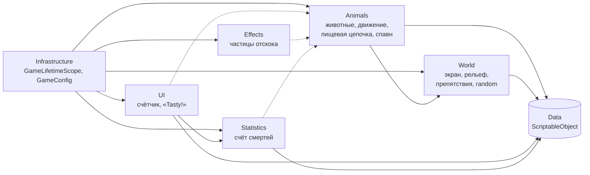
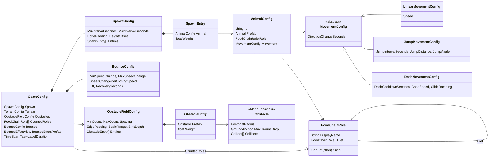
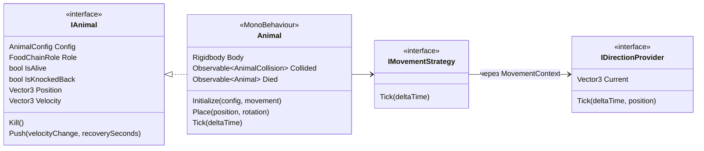
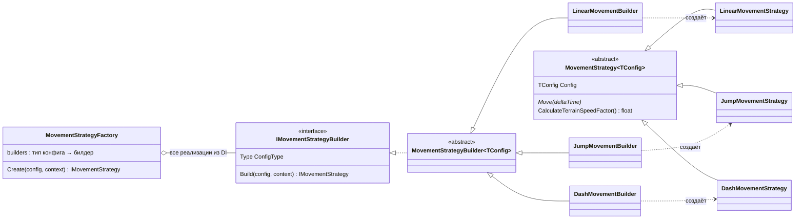
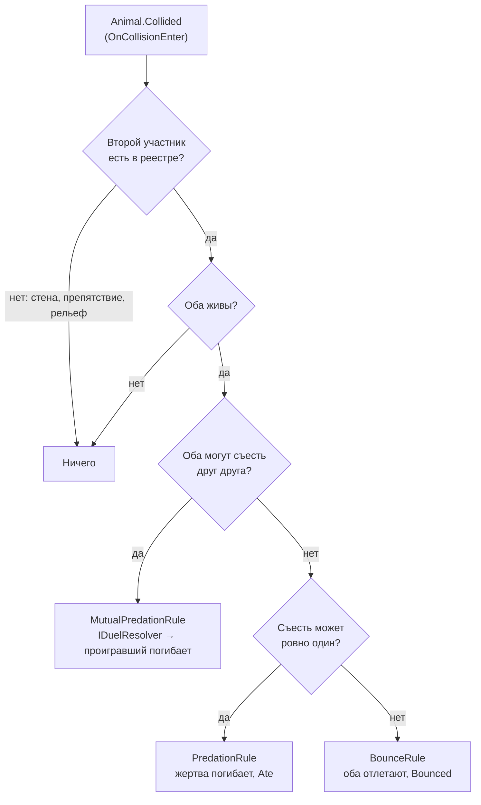
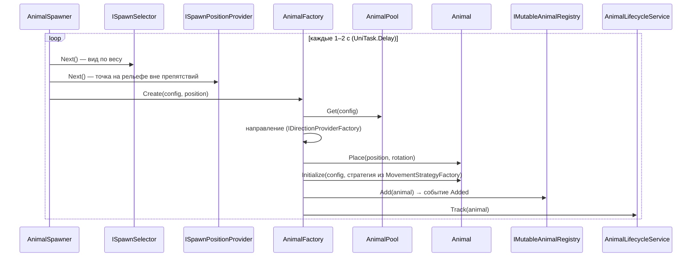
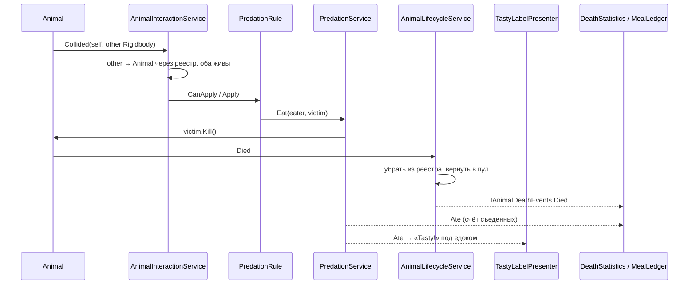
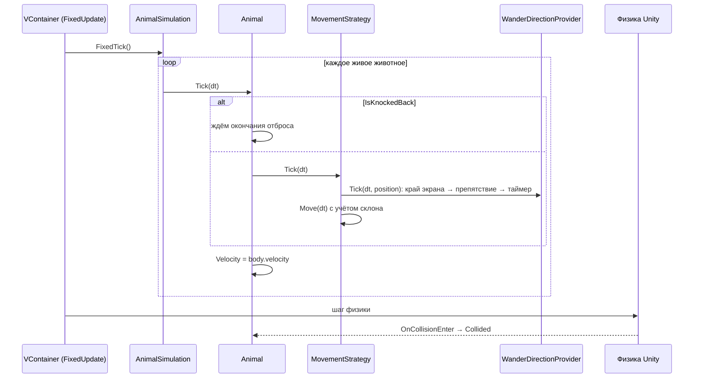
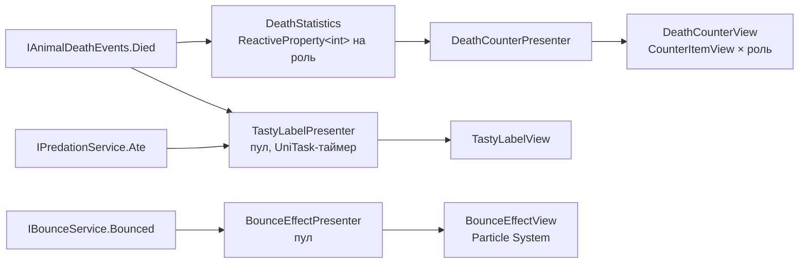

# Архитектура Zoo World

Документ описывает структуру проекта, ответственность модулей и правила расширения.

## 1. Цели

Главная цель — архитектура животных, которую легко читать и расширять. Проект рассчитан на добавление сотен и тысяч видов животных (птицы, пауки, рыбы, крабы и т. д.).

Ключевой принцип:

> **Новое животное — это новые ассеты (ScriptableObject и префаб), без изменения кода.**
> **Новый тип поведения** (полёт, плавание) — это новый класс и одна строка регистрации в DI, без правки существующего кода.

## 2. Технологии

| Технология | Назначение |
|---|---|
| **VContainer** | Внедрение зависимостей, корень композиции, точки входа (`IStartable`, `IAsyncStartable`, `IFixedTickable`) |
| **R3** | Реактивные счётчики и события (`ReactiveProperty`, `Observable`, `Subject`) |
| **UniTask** | Асинхронный цикл спавна, таймер подписи «Tasty!» |
| **ScriptableObject** | Все игровые данные и конфигурация |
| **UnityEngine.Pool** | Пул животных, подписей «Tasty!» и эффектов отскока |
| **uGUI** | Интерфейс |
| **Particle System** (встроенный модуль) | Эффект при отскоке жертв |
| **NaughtyAttributes** | Атрибуты инспектора для конфигов (`HideIf` у seed рельефа) |
| **NUnit** (+ NSubstitute) | Модульные тесты |

Все подключённые пакеты используются в коде. ECS не применяется.

VContainer, UniTask и R3.Unity подключаются через OpenUPM (`Packages/manifest.json`). Ядро R3 и его зависимости лежат в `Assets/Plugins/R3` (DLL из NuGet), NSubstitute и Castle.Core — в `Assets/Plugins/NSubstitute` (только Editor, подключаются явно в тестовой сборке).

## 3. Архитектурные принципы

1. **Данные вместо кода.** Виды животных, роли, параметры движения и пищевая цепочка описываются ScriptableObject.
2. **Композиция вместо наследования.** Поведение животного собирается из стратегий; базовые классы используются только для повторного использования кода.
3. **Открыт для расширения, закрыт для изменения (OCP).** Добавление нового вида, движения или правила не требует правки существующих классов: фабрики и наборы правил получают реализации через DI.
4. **Единственная ответственность (SRP).** Животное двигается и сообщает о событиях. Кто кого ест, как возвращать в пул, как считать смерти и как рисовать интерфейс решают другие классы.
5. **Зависимость от абстракций.** Модули общаются через интерфейсы и потоки событий, конкретные реализации связывает только корень композиции.
6. **Без глобального состояния.** Нет статических экземпляров и статических событий; все зависимости передаются явно.
7. **Один тик.** Обновление всех животных идёт из одной точки (`AnimalSimulation`), порядок вызовов явный.

## 4. Модули и зависимости

Направление зависимостей: сплошная стрелка означает «знает о», пунктир — «подписан на события».



| Модуль | Зависит от | Не зависит от |
|---|---|---|
| `World` | — | `Animals`, `Statistics`, `UI` |
| `Data` (ScriptableObject) | — | остальных модулей |
| `Animals` | `World`, `Data` | `Statistics`, `UI` |
| `Statistics` | `Animals` (интерфейсы и события), `Data` | `UI` |
| `UI` | `Statistics`, `Animals` (только события и интерфейсы), `Data` | конкретных классов животных |
| `Effects` | `Animals` (только события), `Data` | `Statistics`, `UI`, конкретных классов животных |
| `Infrastructure` | все модули (корень композиции) | — |

Циклических зависимостей нет. `UI`, `Effects` и `Statistics` подписываются на события `Animals`, но сами `Animals` ничего о них не знают.

Все модули находятся в одной сборке `ZooWorld.asmdef`, границы между ними задаются папками, namespace и интерфейсами. Тесты вынесены в `ZooWorld.Tests.asmdef`.

### Модуль World

Сервисы окружения, не зависящие от остальной игры:

- `IScreenBounds` / `ScreenBounds` — границы экрана камеры в мировых координатах (находится ли точка внутри, куда повернуть при выходе за границу).
- `IRandomService` — обёртка над генератором случайных чисел; позволяет подменять случайность в тестах.
- `ArenaWalls` (`IStartable`, `ITickable`) — четыре невидимых коллайдера по краям экрана. Жёстко не дают животным выйти за границы и подстраиваются под изменение размера окна. Столкновение со стеной не обрабатывается как столкновение животных, потому что у стены нет `Rigidbody`.

Камера ортографическая с фиксированным `orthographicSize`: размер объектов в пикселях пропорционален высоте окна, а игровое поле всегда одной высоты. Изменение размера окна не меняет геймплей; при другом соотношении сторон меняется только ширина поля.

### Рельеф

Рельеф — процедурный и описывается данными (`TerrainConfig`). Он состоит из независимых частей:

- `TerrainGenerator` строит `HeightField` (сетка высот) из фрактального шума Перлина; seed случайный или фиксированный.
- `TerrainMeshBuilder` превращает `HeightField` в меш с плавными нормалями и цветами вершин, `TerrainPalette` красит по высоте (низины — болотные тона, вершины — светлые) и по крутизне (крутые склоны — землистые). Шейдер `ZooWorld/VertexColorSurface` выводит цвет вершин с освещением и тенями и добавляет мелкую процедурную детализацию по мировым координатам (трёхслойный шум, параметры `_DetailScale` и `_DetailStrength`), благодаря которой поверхность выглядит чёткой при любой плотности сетки.
- `TerrainBuilder` (`IStartable`) создаёт объект с `MeshRenderer` и `MeshCollider`.
- `ITerrain` / `HeightFieldTerrain` — единственный интерфейс, который видят животные: `HeightAt` (спавн на поверхности) и `GetSpeedMultiplier(position, direction)`.

Влияние на движение:

- в гору животное идёт медленнее, под гору быстрее (по крутизне склона вдоль направления, с ограничением `MinSpeedMultiplier`…`MaxSpeedMultiplier`);
- в низинах (`ValleyLevel`) животные вязнут: скорость умножается на `ValleySpeedMultiplier`;
- прыжки учитывают тот же множитель (прыжок в гору короче), а склоны физически отклоняют и тормозят животных.

Множитель считают стратегии через `MovementStrategy.CalculateTerrainSpeedFactor()` (метод, а не свойство: каждый вызов делает несколько выборок высоты), поэтому любое новое движение получает его одной строкой. Крутизна склонов ограничена параметрами шума: лягушки не скатываются со склона (трение), а животные не застревают.

При появлении животного `Animal.Place` выставляет позицию и поворот сразу и `transform`, и своему `Rigidbody` (без глобального `Physics.SyncTransforms`). Без этого тело до первого шага физики остаётся в начале координат, и животное может провалиться сквозь поверхность.

Сетка высот (`HeightField`, `TerrainGenerator`, `TerrainMeshBuilder`) использует одну и ту же математику индексов и координат из `GridMath`, поэтому меш и выборки высоты не могут разойтись.

### Препятствия

Препятствия устроены так же, как рельеф: данные отдельно, генерация отдельно, запросы через интерфейс.

- `ObstacleFieldConfig` (ScriptableObject) — сколько препятствий (`MinCount`…`MaxCount`), минимальный зазор между ними (`Spacing`), отступ от краёв экрана, разброс масштаба, насколько утопить в землю, и список префабов с весами.
- `Obstacle` — компонент на префабе: радиус «следа» на земле (для раскладки), способ постановки на рельеф (`GroundAnchor`), допустимый перепад высоты под препятствием (`MaxGroundDrop`) и список коллайдеров. `GetComponent` во время игры не нужен.
- `ObstacleLayoutGenerator` — чистая функция без Unity-сцены: по конфигу, области экрана, `ITerrain` и `IRandomService` возвращает список `ObstaclePlacement` (префаб, позиция, поворот, масштаб). Препятствия не налезают друг на друга и на края, между ними остаётся проход, а перепад рельефа под каждым не превышает его `MaxGroundDrop`. Покрыта тестами.
- `ObstacleFootprint` — общая выборка высот рельефа под «следом» (центр и 16 точек на половине и полном радиусе). По ней генератор проверяет перепад, а сборщик выбирает высоту, поэтому они не расходятся.
- `ObstacleBuilder` (`IStartable`) расставляет препятствия по раскладке, ставит их на рельеф по `GroundAnchor` и регистрирует в `IObstacleRegistry`.

Постановка на рельеф зависит от формы препятствия:

| Препятствия | `GroundAnchor` | `MaxGroundDrop` | Почему |
|---|---|---|---|
| Валун, куст, бревно, пень | `Lowest` — по самой низкой точке | 0.25 м | Компактные: чуть утопить в землю естественно, висеть над склоном нельзя |
| Прямая и угловая ограда | `Highest` — по самой высокой точке | 0.55 м | Длинные: при постановке по низкой точке верхний по склону край уходил под землю вместе с коллайдером, и животные проходили сквозь ограду. Столбы и коллайдер уходят на 0.6 м ниже основания, поэтому на нижнем конце ограда всё равно стоит в земле и под ней нет щели |

`ObstacleGroundingTests` проверяет это на настоящем рельефе и настоящих ассетах (60 случайных раскладок): ограды появляются, видимая высота ограды всюду не меньше 0.5 м, а низ коллайдера всюду под землёй.
- `IObstacleMap` / `ObstacleField` — единственное, что видят животные: `TryFindObstacle(point, radius, out closestPoint)`. Это физический запрос (`OverlapSphereNonAlloc`) с фильтром по коллайдерам препятствий, поэтому форма учитывается точно, в том числе у L-образной ограды.

Набор префабов в `Prefabs/Obstacles`: валун со мхом, куст с цветами, бревно, пень с грибом, прямая и угловая деревянная ограда вольера. Всё собрано из примитивов в той же стилистике, что и животные. У коллайдеров скользкий физический материал `Obstacle`, поэтому животные не залипают, а соскальзывают вдоль препятствия. `Rigidbody` у препятствий нет, поэтому столкновение с ними, как и со стеной арены, не считается столкновением животных.

Как животные это используют:

- `WanderDirectionProvider` смотрит на `ObstacleLookAhead` вперёд. Если там препятствие, направление отражается от его поверхности (`Vector3.Reflect` по нормали от ближайшей точки) с небольшим случайным разбросом. Животное обходит препятствие, а не бьётся в него до смены направления. Разворот от края экрана важнее обхода. Стратегии движения про препятствия ничего не знают, поэтому любое новое движение получает обход автоматически.
- `ScreenSpawnPositionProvider` не ставит животное внутрь препятствия: если точка занята, он берёт другую (до 12 попыток).

## 5. Модель данных



| Ассет | Содержимое |
|---|---|
| `GameConfig` | Спавн (`SpawnConfig`), ссылки на рельеф и препятствия, роли для счётчика, отскок (`BounceConfig`) и префаб его эффекта, длительность «Tasty!» |
| `ObstacleFieldConfig` | Количество препятствий, зазоры, отступы, масштаб, префабы с весами |
| `Prey` (`FoodChainRole`) | `Diet`: пусто |
| `Predator` (`FoodChainRole`) | `Diet`: Prey, Predator |
| `FrogJump`, `RabbitJump`, `CrabJump` (`JumpMovementConfig`) | `JumpIntervalSeconds`, `JumpDistance`, `JumpAngle` |
| `SnakeLinear`, `MouseLinear` (`LinearMovementConfig`) | `Speed` |
| `FoxDash` (`DashMovementConfig`) | `DashCooldownSeconds`, `DashSpeed`, `GlideDamping` |
| `TerrainConfig` (`TerrainConfig`) | Размер, шум, диапазон высот, влияние на скорость, материалы и палитра |

Животные (`AnimalConfig`: префаб, роль, движение):

| Жертвы (`Prey`) | Движение | Хищники (`Predator`) | Движение |
|---|---|---|---|
| `Frog` | `FrogJump` — прыжки | `Snake` | `SnakeLinear` — ползёт линейно |
| `Rabbit` | `RabbitJump` — длинные прыжки | `Fox` | `FoxDash` — рывки с затуханием |
| `Mouse` | `MouseLinear` — быстрый бег | `Crab` | `CrabJump` — короткие низкие прыжки |

Кролик, мышь и краб добавлены только ассетами. Для лисы добавлен новый тип движения (`DashMovementConfig`, `DashMovementStrategy`, `DashMovementBuilder` и одна строка в DI), существующие классы не менялись.

Особенности:

- У каждого типа движения свой конфиг без лишних полей (у линейного движения нет параметров прыжка).
- Пищевая цепочка описана ролью и списком `Diet`. Код нигде не проверяет конкретный вид животного.
- Частота появления задаётся весом в `SpawnConfig`. Записи с нулевым весом не выпадают никогда, запись без животного — ошибка при старте.
- Целостность ассетов (ссылки в `AnimalConfig`, уникальные `Id`, настройки спавна и отскока, префабы препятствий) проверяет `ConfigAssetsTests`, поэтому сломанный конфиг ловится тестом, а не в рантайме.

## 6. Животное



`Animal` — тонкий `MonoBehaviour`.

**Отвечает за:**
- хранение конфига и состояния (`IsAlive`, `IsKnockedBack`);
- передачу тика в стратегию движения и запоминание скорости после него (`Velocity` — скорость, с которой животное входит в шаг физики);
- публикацию событий столкновения (`Collided`) и смерти (`Died`) через `Observable`;
- методы `Kill()` и `Push(velocityChange, recoverySeconds)`: толчок меняет скорость тела, и на время восстановления стратегия движения не управляет телом, иначе линейное движение сразу погасило бы отскок.

**Не отвечает за:**
- решение о том, кто кого ест;
- возврат в пул, статистику, интерфейс;
- поиск других объектов (`GetComponent`, `Find*`).

Всё необходимое передаётся в `Initialize(...)` фабрикой.

### Движение

- **`LinearMovementStrategy`** — задаёт горизонтальную скорость `направление × Speed`, сохраняя вертикальную составляющую.
- **`JumpMovementStrategy`** — раз в `JumpIntervalSeconds` сообщает импульс, рассчитанный так, чтобы баллистический прыжок покрыл `JumpDistance` (`v = √(d·g / sin 2θ)`).
- **`DashMovementStrategy`** — раз в `DashCooldownSeconds` делает рывок со скоростью `DashSpeed`, между рывками скорость затухает с коэффициентом `GlideDamping`.
- **`WanderDirectionProvider`** выбирает случайное направление и разворачивает животное к экрану, когда оно выходит за границы или через `EdgeLookAhead` выйдет за них при текущем направлении. Жёсткую границу обеспечивают `ArenaWalls`, разворот нужен, чтобы животное не упиралось в стену. Препятствия впереди он обходит отражением направления (см. раздел «Препятствия»). Стратегии про экран и препятствия ничего не знают, поэтому любое новое движение получает это поведение автоматически.
- **`MovementStrategy<TConfig>`** — базовый класс для повторного использования кода: перед `Move` обновляет `IDirectionProvider`, даёт типизированный доступ к конфигу.
- **`IDirectionProviderFactory`** (`WanderDirectionProviderFactory`) создаёт провайдер направления для каждого животного; другой способ выбора направления подключается заменой регистрации.

### Создание стратегии без `switch`



`MovementStrategyFactory` получает из DI список `IMovementStrategyBuilder` и строит словарь «тип конфига → билдер». Чтобы добавить новое движение, достаточно конфига, стратегии, билдера и регистрации в DI.

## 7. Пищевая цепочка



`AnimalInteractionService` при столкновении находит второго участника через `IAnimalRegistry` и применяет первое подходящее `IInteractionRule`.

| Правило | Условие | Действие |
|---|---|---|
| `MutualPredationRule` | Каждый может съесть другого (хищник и хищник) | `IDuelResolver` выбирает победителя (больше всего съел), проигравший умирает |
| `PredationRule` | Съесть может ровно один | Съеденное животное умирает, публикуется событие `Ate` |
| `BounceRule` | Никто не может съесть другого (жертва и жертва) | `IBounceService` расталкивает обоих с силой, зависящей от скорости сближения, публикуется событие `Bounced` |

Детали:

- Победитель дуэли хищников выбирается `MostMealsDuelResolver`: побеждает тот, кто за свою жизнь съел больше животных (хищники тоже считаются). При равенстве решает запасной `IDuelResolver` (в корне композиции это `RandomDuelResolver`). Реализацию легко заменить, например, по массе.
- `MealLedger` ведёт счёт съеденных: подписан на `Ate` (счётчик едока растёт) и на `Died` (запись удаляется, поэтому животное из пула начинает с нуля). Счётчик хранится отдельно от `Animal`, чтобы животное оставалось тонким.
- `OnCollisionEnter` вызывается у обоих участников; повторная обработка исключается проверкой, что оба животных ещё живы.
- Участник столкновения определяется по `collision.rigidbody` через реестр, без `GetComponent`.
- `AnimalInteractionService` — точка входа (`IInitializable`): подписывается на `AnimalRegistry.Added` и для каждого появившегося животного слушает `Collided` до его `Died` или до `Dispose` самого сервиса (`AnimalLifecycleService` устроен так же). Метод `Resolve(IAnimal, IAnimal)` не зависит от Unity и покрыт тестами.
- Новое правило (например, ядовитая жертва) — новый класс и регистрация в DI перед остальными. Сейчас условия трёх правил не пересекаются (для любой пары подходит ровно одно, это проверяет `InteractionRulesTests`), поэтому их порядок не важен; для нового правила, которое пересекается с существующими, порядок регистрации и есть приоритет.

### Отскок

Физический материал `Animal` (bounciness 0.6) по-прежнему даёт естественный разлёт, а `BounceService` добавляет к нему управляемый толчок:

- направление — от второго животного по горизонтали, плюс подъём `Lift`;
- величина — `MinSpeedChange + скорость сближения × SpeedChangePerClosingSpeed`, но не больше `MaxSpeedChange`. Скорость сближения считается по `IAnimal.Velocity` (скорость до шага физики), поэтому быстрая мышь, влетевшая в лягушку, разлетается сильнее, чем две стоящие лягушки;
- после толчка животное `RecoverySeconds` не управляется стратегией движения (`IsKnockedBack`);
- `OnCollisionEnter` приходит обоим участникам; второй вызов отбрасывается, потому что оба уже `IsKnockedBack`. Поэтому на одно столкновение — один толчок и один эффект;
- параметры лежат в `GameConfig` (секция Bounce, `BounceConfig`).

`Bounced` несёт точку контакта и нормированную силу (0…1). На него подписан `BounceEffectPresenter` (модуль `Effects`): он берёт из пула `BounceEffectView` и проигрывает префаб `Prefabs/Effects/BounceEffect` — разноцветные искры, «пуф» и пыль. Чем сильнее удар, тем крупнее эффект, тем больше искр и тем быстрее они летят. Экземпляр возвращается в пул по `OnParticleSystemStopped`. Модуль Particle System включён в `Packages/manifest.json`.

### Реестр и события смерти

- `IAnimalRegistry` — только чтение: список живых животных, событие `Added`, поиск по `Rigidbody`. Его получают симуляция и сервис взаимодействий.
- `IMutableAnimalRegistry` добавляет `Add` и `Remove`; его получают только `AnimalFactory` и `AnimalLifecycleService`.
- Смерть публикуется дважды и в строгом порядке: сначала `Animal.Died` (животное ещё в реестре и не в пуле, на него подписан `AnimalLifecycleService`), затем `IAnimalDeathEvents.Died` (животное уже убрано из реестра и возвращено в пул). Статистика, `MealLedger` и UI слушают только второе событие.

## 8. Сценарии

### Спавн



На `Added` подписан `AnimalInteractionService`: с этого момента он слушает столкновения нового животного.

### Столкновение и «Tasty!»



Отскок проходит тот же путь, только вместо `PredationRule` срабатывает `BounceRule`, а `BounceService` публикует `Bounced`, на который подписан `BounceEffectPresenter`.

### Тик симуляции



`AnimalSimulation` реализует `IFixedTickable` и вызывает `Tick` у всех живых животных. Это единая точка обновления вместо `FixedUpdate` в каждом объекте.

## 9. Интерфейс (MVP)



- `DeathStatistics` — модель: для каждой роли из `GameConfig.CountedRoles` хранит `ReactiveProperty<int>` и сама подписывается на событие смерти.
- `DeathCounterPresenter` создаёт по одному `CounterItemView` на роль и связывает его с моделью. Новая роль — новый ассет в списке, без дублирования кода.
- `DeathCounterView` и `CounterItemView` пассивные: только отображают значения.
- `TastyLabelPresenter` подписывается на `Ate`, показывает подпись под хищником и скрывает её через `TastyLabelDuration` (`UniTask`); если хищник уничтожен раньше (событие `Died`), подпись скрывается сразу. Позиция подписи обновляется в `ILateTickable`. Подписи берутся из пула. Длительность передаётся в конструктор как `TimeSpan`, поэтому UI не зависит от `GameConfig`.
- `BounceEffectPresenter` (модуль `Effects`) устроен так же: подписка на `Bounced`, пул `BounceEffectView`, возврат в пул по окончании эффекта.
- Подписки хранятся в `CompositeDisposable` и освобождаются в `Dispose()`.

## 10. Корень композиции

```mermaid
flowchart TB
    Scope["GameLifetimeScope<br/>(GameConfig)"]
    Scope --> W["RegisterWorld<br/>Camera, ScreenBounds, RandomService, ArenaWalls"]
    Scope --> T["RegisterTerrain<br/>HeightField, HeightFieldTerrain, TerrainBuilder"]
    Scope --> O["RegisterObstacles<br/>ObstacleField, ObstacleBuilder"]
    Scope --> M["RegisterMovement<br/>билдеры, MovementStrategyFactory, WanderDirectionProviderFactory"]
    Scope --> FC["RegisterFoodChain<br/>правила, дуэли, MealLedger, PredationService, AnimalInteractionService"]
    Scope --> B["RegisterBounce<br/>BounceConfig, BounceService"]
    Scope --> LC["RegisterLifecycle<br/>AnimalRegistry, AnimalPool, AnimalLifecycleService, AnimalFactory, AnimalSimulation"]
    Scope --> S["RegisterSpawning<br/>SpawnConfig, WeightedSpawnSelector, ScreenSpawnPositionProvider, AnimalSpawner"]
    Scope --> St["RegisterStatistics<br/>DeathStatistics"]
    Scope --> UI["RegisterUI<br/>DeathCounterPresenter, TastyLabelPresenter"]
    Scope --> E["RegisterEffects<br/>BounceEffectPresenter"]
```



`GameLifetimeScope` — единственное место, где известны конкретные реализации. Регистрации можно разделить по инсталлерам (`AnimalsInstaller`, `StatisticsInstaller`, `UIInstaller`).

Точки входа: `AnimalSpawner` (`IAsyncStartable`), `AnimalSimulation` (`IFixedTickable`), `AnimalInteractionService` (`IInitializable`), `MealLedger` (`IInitializable`), `DeathCounterPresenter`, `TastyLabelPresenter`, `BounceEffectPresenter`, а также `ArenaWalls`, `TerrainBuilder` и `ObstacleBuilder` (`IStartable`). Регистрации сгруппированы по модулям в методах `RegisterWorld`, `RegisterTerrain`, `RegisterObstacles`, `RegisterMovement`, `RegisterFoodChain`, `RegisterBounce`, `RegisterLifecycle`, `RegisterSpawning`, `RegisterStatistics`, `RegisterUI`, `RegisterEffects`. Глобальной машины состояний и менеджера игры нет: сцена одна, запуск полностью определяется точками входа контейнера.

Порядок регистрации `IInteractionRule` определяет приоритет правил.

## 11. Структура проекта

```
Assets/_Project/
├── Configs/
│   ├── GameConfig.asset
│   ├── TerrainConfig.asset
│   ├── ObstacleFieldConfig.asset
│   ├── Animals/          Frog, Rabbit, Mouse, Snake, Fox, Crab
│   ├── Movement/         FrogJump, RabbitJump, CrabJump, SnakeLinear, MouseLinear, FoxDash
│   └── FoodChain/        Prey.asset, Predator.asset
├── Materials/            материалы и физические материалы примитивов
├── Shaders/              VertexColorSurface.shader (цвет вершин рельефа)
├── Prefabs/
│   ├── Animals/          Frog, Rabbit, Mouse, Snake, Fox, Crab
│   ├── Effects/          BounceEffect.prefab
│   ├── Obstacles/        Boulder, Bush, Log, Stump, FenceStraight, FenceCorner
│   └── UI/               CounterItemView.prefab, TastyLabelView.prefab
├── Scenes/               Game.unity
├── Scripts/
│   ├── ZooWorld.asmdef
│   ├── Animals/
│   │   ├── Core/          IAnimal, Animal, AnimalConfig, IAnimalRegistry, IMutableAnimalRegistry, AnimalRegistry
│   │   ├── Movement/      IMovementStrategy, *Config, *Strategy, *Builder, MovementStrategyFactory
│   │   ├── Direction/     IDirectionProvider, WanderDirectionProvider, *Factory
│   │   ├── FoodChain/     FoodChainRole, IInteractionRule, *Rule, IDuelResolver, PredationService, BounceService, AnimalInteractionService, MealLedger
│   │   ├── Lifecycle/     AnimalFactory, AnimalPool, AnimalLifecycleService, AnimalSimulation
│   │   └── Spawning/      AnimalSpawner, SpawnConfig, ISpawnSelector, ISpawnPositionProvider
│   ├── Statistics/       DeathStatistics
│   ├── Effects/
│   │   └── Bounce/        BounceEffectPresenter, BounceEffectView
│   ├── World/            IScreenBounds, ScreenBounds, IRandomService, UnityRandomService, ArenaWalls
│   │   ├── Terrain/       ITerrain, HeightFieldTerrain, HeightField, TerrainGenerator, TerrainMeshBuilder, TerrainPalette, TerrainBuilder, TerrainConfig
│   │   └── Obstacles/     ObstacleFieldConfig, ObstacleLayoutGenerator, ObstacleFootprint, ObstacleBuilder, IObstacleMap, ObstacleField, Obstacle
│   ├── UI/
│   │   ├── DeathCounter/  DeathCounterPresenter, DeathCounterView, CounterItemView
│   │   └── TastyLabel/    TastyLabelPresenter, TastyLabelView
│   └── Infrastructure/   GameLifetimeScope, GameConfig
└── Tests/
    └── EditMode/         ZooWorld.Tests.asmdef
```

Namespace соответствует папке: `ZooWorld.Animals.Movement`, `ZooWorld.UI.DeathCounter` и т. д.

## 12. Расширение

| Что добавляем | Что делаем | Код |
|---|---|---|
| Паук (жертва, ползает) | Префаб, `Spider.asset` (`AnimalConfig`), `SpiderLinear.asset`, роль `Prey` | Не меняется |
| Краб (хищник, прыгает) | Префаб, `Crab.asset`, `CrabJump.asset` | Не меняется |
| Птица (летает, ест лягушек) | Новая роль с `Diet`; `FlyMovementConfig`, `FlyMovementStrategy`, `FlyMovementBuilder` | 3 новых класса и 1 строка в DI |
| Ядовитое животное | `PoisonRule` | 1 новый класс и 1 строка в DI |
| Частота появления | Вес в `SpawnConfig` | Не меняется |
| Новое препятствие (пруд, валун другой формы) | Префаб с коллайдерами и компонентом `Obstacle`, строка в `ObstacleFieldConfig` | Не меняется |

Префаб животного содержит `Rigidbody`, коллайдер и компонент `Animal`; для новых префабов удобно использовать префаб-вариант базового.

Счётчик смертей ведётся по ролям из `GameConfig.CountedRoles`; новая роль появится в интерфейсе после добавления в этот список.

## 13. Тестирование

Модульные тесты (EditMode, NUnit):

| Тест | Что проверяет |
|---|---|
| `FoodChainRoleTests` | Метод `CanEat` по `Diet` |
| `InteractionRulesTests` | Жертва и жертва: отскок без смертей; жертва и хищник: умирает жертва, публикуется `Ate`, отскока нет; хищник и хищник: остаётся ровно один; для любой пары подходит ровно одно правило |
| `BounceServiceTests` | Стоящих расталкивает минимальной силой в разные стороны, быстрое сближение толкает сильнее, сила ограничена максимумом, событие в точке между животными, повторный вызов во время отброса игнорируется |
| `HeightFieldTests` | Интерполяция высоты, градиент, поведение за краем поля |
| `HeightFieldTerrainTests` | Множитель скорости: в гору медленнее, под гору быстрее, в низине медленнее, ограничение |
| `TerrainGenerationTests` | Диапазон высот, размер, повторяемость и разнообразие, наличие холмов и низин |
| `TerrainMeshBuilderTests` | Число вершин и треугольников, нормали вверх, цвета вершин |
| `MealLedgerTests` | Счётчик растёт только у едока, хищник как жертва тоже считается, смерть обнуляет счёт |
| `MostMealsDuelResolverTests` | Побеждает съевший больше, при равенстве решает запасной резолвер |
| `ArenaWallsTests` | Стены стоят вплотную за краем экрана, внутри области свободно |
| `WanderDirectionProviderTests` | У края направление разворачивается до выхода за границу, внутри не меняется; препятствие впереди — отражается, препятствие позади — не мешает |
| `ObstacleLayoutGeneratorTests` | Количество в заданном диапазоне, препятствия внутри области с отступом и на заданном расстоянии друг от друга, на склоне перепад под каждым не больше допустимого, пустой список — пустая раскладка |
| `ObstacleGroundingTests` | На настоящем рельефе ограды появляются, не уходят под землю и не висят над ней |
| `ScreenSpawnPositionProviderTests` | Точка внутри препятствия отбрасывается, свободная возвращается с первой попытки |
| `AnimalInteractionServiceTests` | Повторное событие от второго участника ничего не меняет |
| `DeathStatisticsTests` | Счётчик увеличивается по нужной роли |
| `MovementStrategyFactoryTests` | Для каждого конфига находится билдер, для неизвестного — понятное исключение |
| `JumpMathTests` | Рассчитанная скорость даёт заданную дистанцию прыжка |
| `AnimalLifecycleServiceTests` | Смерть убирает животное из реестра, возвращает в пул и публикуется один раз; после `Dispose` сервис животных не трогает |
| `WeightedSpawnSelectorTests` | Выбор по весу, записи с нулевым весом не выпадают, ошибки конфигурации видны сразу |
| `ConfigAssetsTests` | Все ассеты в `Configs/`: ссылки животных заполнены, `Id` уникальны, настройки спавна и отскока корректны, префаб эффекта назначен, у каждого препятствия есть коллайдеры и радиус |

Правила работают с `IAnimal`, поэтому тестируются без сцены.

## 14. Соглашения по коду

- Стиль: Microsoft C# Coding Conventions; настройки хранятся в `.editorconfig`.
- Методы короткие (около 20 строк), используются ранние `return`, глубокая вложенность не допускается.
- Имена классов без подчёркиваний; модификаторы доступа указываются явно; приватные поля — `_camelCase`.
- Константы и конфиги вместо магических чисел и строк.
- Комментарии не пересказывают код; сложные места выделяются в методы с говорящими именами.
- Без `GetComponent` в обработчиках столкновений и в `Update`.
- События публикуются через `Observable`/`Subject`; статические события и глобальные экземпляры не используются.
- Каждый подключённый пакет используется.

## 15. Что намеренно не делается

- ECS.
- Глобальная машина состояний, загрузочные сцены, сохранения.
- Собственные фреймворки событий или внедрения зависимостей.
- Проработанная графика и дополнительные ассеты.
